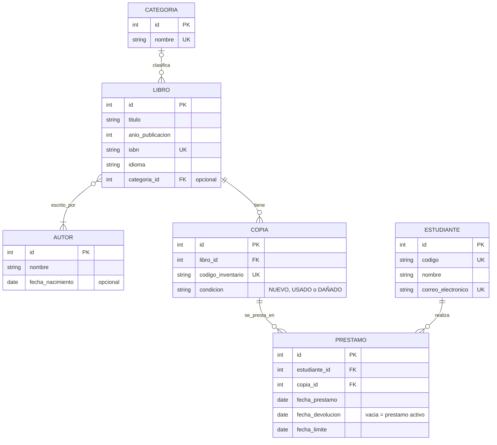

# 📚 Biblioteca UFPS

Sistema de gestión de préstamos para la biblioteca de la UFPS, hecho con Django. Lleva el registro de los libros, sus autores y categorías, las copias físicas de cada libro, los estudiantes y los préstamos. La bibliotecaria lo usa desde el panel de administración para registrar préstamos y devoluciones sin conocimientos técnicos, y el sistema impide que una misma copia se preste dos veces al mismo tiempo.

Actividad de la asignatura Programación Web, Ingeniería de Sistemas, UFPS. Profesor Daniel Esteban.

---

## 🛠️ Tecnologías

| Herramienta | Versión |
|---|---|
| Python | 3.14.9 |
| Django | 6.1.3 |
| Base de datos | SQLite (la que trae Django por defecto) |

---

## 🚀 Instalación y ejecución

Comandos para Windows (PowerShell). En Linux o Mac el entorno se activa con `source venv/bin/activate`.

```bash
# 1. Clonar el repositorio
git clone https://github.com/Jasnothere/Biblioteca.git
cd Biblioteca

# 2. Crear y activar el entorno virtual
python -m venv venv
venv\Scripts\activate

# 3. Instalar dependencias
pip install -r requirements.txt

# 4. Crear las tablas en la base de datos
python manage.py migrate

# 5. Crear un usuario administrador (pide usuario, correo y contraseña)
python manage.py createsuperuser

# 6. (Opcional) Cargar datos de prueba
python manage.py shell
>>> exec(open('cargar_datos.py', encoding='utf-8').read())
>>> exit()

# 7. Arrancar el servidor
python manage.py runserver
```

Después entra a http://127.0.0.1:8000/admin/ con el usuario del paso 5.

---

## 📁 Estructura del proyecto

```
Biblioteca/
├── config/                 # Configuración del proyecto Django
│   ├── settings.py         # Apps instaladas, base de datos, idioma, etc.
│   └── urls.py             # Rutas principales (incluye /admin/)
├── biblioteca/             # App principal
│   ├── models.py           # Modelos: Categoria, Autor, Libro, Copia, Estudiante, Prestamo
│   ├── admin.py            # Personalización del panel de administración
│   └── migrations/         # Historial de cambios de la base de datos (0001, 0002, 0003)
├── cargar_datos.py         # Script con datos de prueba para las consultas del ORM
├── manage.py               # Comandos de Django (runserver, migrate, shell...)
├── requirements.txt        # Dependencias del proyecto
└── README.md               # Este archivo
```

La base de datos `db.sqlite3` y el entorno virtual `venv/` no se suben al repositorio (están en `.gitignore`). Cada persona los crea con los pasos de instalación.

---

## 🗂️ Modelo de datos



### Relaciones

- **Categoría → Libro (uno a muchos, opcional):** una categoría clasifica cero o muchos libros, y un libro tiene cero o una categoría. Es `ForeignKey` con `on_delete=SET_NULL` y `null=True`: si se borra una categoría, sus libros no se pierden, solo quedan sin categoría.
- **Libro ↔ Autor (muchos a muchos):** un libro tiene uno o varios autores, y un autor puede tener cero o muchos libros. Es `ManyToManyField`, así que Django crea la tabla intermedia `biblioteca_libro_autor`.
- **Libro → Copia (uno a muchos):** un libro tiene cero o muchas copias físicas, y cada copia es de exactamente un libro. Es `on_delete=PROTECT`: no se puede borrar un libro que todavía tenga copias.
- **Copia → Préstamo (uno a muchos):** una copia se presta cero o muchas veces a lo largo del tiempo, y cada préstamo es de exactamente una copia. Es `PROTECT`, para no perder el historial.
- **Estudiante → Préstamo (uno a muchos):** un estudiante realiza cero o muchos préstamos, y cada préstamo es de exactamente un estudiante. Es `PROTECT`, por la misma razón.

### Regla de negocio: una copia no puede tener dos préstamos activos

Un préstamo está **activo** mientras su `fecha_devolucion` está vacía. La regla se implementó con un **constraint** en la base de datos, no con `clean()`:

```python
class Meta:
    constraints = [
        models.UniqueConstraint(
            fields=['copia'],
            condition=Q(fecha_devolucion__isnull=True),
            name='una_copia_un_prestamo_activo',
            violation_error_message='Esta copia ya tiene un préstamo activo y no puede ser prestada nuevamente hasta que sea devuelta.'
        )
    ]
```

**Por qué constraint y no `clean()`:** `clean()` solo se ejecuta si alguien llama a `full_clean()` (el admin lo hace, pero el shell, un script o una API no). El constraint vive en la base de datos, así que se cumple siempre, sin importar desde dónde se guarde el préstamo. Además, el admin lo valida antes de guardar y muestra el `violation_error_message`.

**En la base de datos** se convierte en un índice único parcial (visto con `python manage.py sqlmigrate biblioteca 0001`):

```sql
CREATE UNIQUE INDEX "una_copia_un_prestamo_activo" ON "biblioteca_prestamo" ("copia_id") WHERE "fecha_devolucion" IS NULL;
```

**Prueba:** al intentar crear desde el shell un segundo préstamo activo para la copia INV-001, la base de datos lo rechazó:

```
IntegrityError: UNIQUE constraint failed: biblioteca_prestamo.copia_id
```

### Migraciones

| Migración | Cambio | Nota |
|---|---|---|
| `0001_initial` | Crea las 7 tablas (6 modelos + la intermedia `biblioteca_libro_autor`) | |
| `0002_libro_idioma` | `AddField` del campo obligatorio `idioma` | Ya había libros, así que Django pidió un valor provisional para las filas existentes. Se usó "Español" solo para esa migración (`preserve_default=False`). |
| `0003` | `AlterField` de `fecha_prestamo`: de `auto_now_add=True` a `default=date.today` | Para poder registrar préstamos con fechas pasadas en las pruebas. Django no preguntó nada porque las filas ya tenían valor. |

---

## 🧑‍💼 Panel de administración

| Modelo | Qué se personalizó | Qué necesidad de la bibliotecaria resuelve |
|---|---|---|
| Libro | `list_display` (título, ISBN, año, categoría, idioma), `search_fields` (título, ISBN), `list_filter` (categoría, idioma) | Ver los datos clave de un vistazo y encontrar un libro por título o ISBN |
| Libro | `inlines` con las copias | Registrar varias copias nuevas de un libro en una sola pantalla, sin elegir el libro cada vez |
| Copia | `list_filter` por condición | Ver de un clic las copias DAÑADAS para repararlas o retirarlas |
| Copia | `search_fields` (código, título del libro) | Encontrar una copia por su código de inventario |
| Copia | Acción "Marcar como dañado" | Marcar varias copias dañadas a la vez |
| Estudiante | `search_fields` (nombre, código) | Encontrar a un estudiante por código o por nombre |
| Estudiante | `inlines` con sus préstamos | Ver el historial de préstamos de un estudiante dentro de su ficha |
| Préstamo | `list_display` con `fecha_limite` | Ver de un vistazo qué préstamos están vencidos |
| Préstamo | `search_fields` (nombre y código del estudiante, código de la copia) | Encontrar rápido los préstamos de un estudiante cuando viene a devolver |
| Préstamo | `list_filter` por `fecha_devolucion` ("Sin fecha") | Ver qué préstamos siguen sin devolverse |
| Préstamo | `list_filter` por `fecha_prestamo` | Reportes por período ("préstamos de este mes") |
| Préstamo | Acción "Marcar como devuelto (hoy)" | Devolver varios préstamos de un clic. Solo afecta a los que no tienen fecha de devolución, para no reescribir devoluciones anteriores |

**Mini reto de la bibliotecaria:**
1. Buscar un estudiante por código o nombre → `search_fields` de EstudianteAdmin y PrestamoAdmin.
2. Ver qué préstamos siguen sin devolverse → filtro "Sin fecha" de `fecha_devolucion`, y `fecha_limite` en la lista.
3. Registrar un préstamo sin confundir copias → el `__str__` de Copia muestra el código de inventario y el título del libro en el desplegable.
4. Opcional, acción para marcar como devueltos → hecho.

---

## 🔍 Consultas del ORM

Todas se ejecutaron en `python manage.py shell` con los datos de `cargar_datos.py`. Antes de ejecutar cada una se escribió la predicción.

### Reto 1: crear un autor, un libro de ese autor y dos copias
```python
novela = Categoria.objects.get(nombre='Novela')
richard = Autor.objects.create(nombre='Richard Linklater')
kim = Autor.objects.create(nombre='Kim Krizan')
sunshine = Libro.objects.create(titulo='Before Sunshine', isbn='9780307477676', anio_publicacion=1995, categoria=novela, idioma='Español')
sunshine.autor.add(richard)
sunset = Libro.objects.create(titulo='Before Sunset', isbn='9780307476767', anio_publicacion=1997, categoria=novela, idioma='Español')
sunset.autor.add(kim)
Copia.objects.create(libro=sunshine, codigo_inventario='INV-020', condicion='USADO')
Copia.objects.create(libro=sunshine, codigo_inventario='INV-021', condicion='DAÑADO')
Copia.objects.create(libro=sunset, codigo_inventario='INV-022', condicion='USADO')
Copia.objects.create(libro=sunset, codigo_inventario='INV-023', condicion='DAÑADO')
```
- **Predicción:** se crean los autores Richard y Kim, los libros Before Sunshine y Before Sunset (cada uno con su autor) y, por cada libro, una copia USADO y una DAÑADO.
- **Resultado:** `sunshine.autor.all()` → Richard Linklater; `sunshine.copias.all()` → INV-020 (USADO), INV-021 (DAÑADO); `sunset.autor.all()` → Kim Krizan; `sunset.copias.all()` → INV-022, INV-023. ✅ Coincide.
- **Nota:** el autor se agrega con `.add()` después del `create`, porque la fila de la tabla intermedia necesita el id del libro, y ese id solo existe cuando el libro ya está guardado.

### Reto 2: libros de un autor, buscándolo por nombre
```python
Libro.objects.filter(autor__nombre__icontains='gabriel')
```
- **Predicción:** 2 libros de Gabriel García Márquez.
- **Resultado:** Cien años de soledad y El amor en los tiempos del cólera. ✅ Coincide.
- **Nota:** `__` cruza dos niveles (libro → autor → nombre). Con `icontains` saldrían también los libros de otro autor llamado "Gabriel"; para un solo autor es más preciso `autor__nombre='Gabriel García Márquez'`.

### Reto 3: libros cuyo título contiene una palabra, sin importar mayúsculas
```python
Libro.objects.filter(titulo__icontains='code')
```
- **Predicción:** los libros con "code" en el título.
- **Resultado:** solo Clean Code. "Python Crash Course" no sale, porque "Course" no contiene "code". ✅
- **Error del primer intento:** `nombre_icontains`. Libro no tiene campo `nombre` (es `titulo`), y entre el campo y el lookup van dos guiones bajos.

### Reto 4: copias disponibles (sin préstamo activo)
Primera versión (incorrecta):
```python
Copia.objects.exclude(prestamos__fecha_devolucion__isnull=True)
```
- **Predicción:** 14 copias − 3 prestadas = 11, sin INV-004, INV-005 ni INV-006.
- **Resultado:** ❌ 4 copias (INV-001, 002, 008, 009).
- **Por qué:** dio 4 porque, al formular la búsqueda con `exclude`, tomaba como prestadas las copias que nunca se habían prestado. Al unir las tablas (JOIN), una copia sin préstamos queda con la `fecha_devolucion` vacía, igual que un préstamo activo, así que también se excluyó.

Versión correcta (en dos pasos):
```python
activos = Prestamo.objects.filter(fecha_devolucion__isnull=True)
Copia.objects.exclude(prestamos__in=activos)
Copia.objects.exclude(prestamos__in=activos).count()
```
- **Resultado:** 11 copias, sin INV-004, 005 ni 006. ✅ Coincide. `activos` es perezoso, así que Django lo mete como subconsulta y todo es una sola consulta.

### Reto 5: estudiantes con al menos un préstamo activo, sin repetir
```python
Estudiante.objects.filter(prestamos__fecha_devolucion__isnull=True).distinct()
```
- **Predicción:** Ana, Luis y Carla. Diego no.
- **Resultado:** Ana, Luis y Carla. ✅ Coincide.
- **Por qué `distinct()`:** al cruzar de un estudiante a sus préstamos, el estudiante sale una vez por cada préstamo que cumpla la condición. Con dos préstamos activos aparecería repetido.

### Reto 6: cuántos préstamos ha hecho cada estudiante (incluidos los devueltos)
```python
from django.db.models import Count
estudiantes = Estudiante.objects.annotate(total_prestamos=Count('prestamos'))
for e in estudiantes:
    print(e.nombre, e.total_prestamos)
```
- **Predicción:** Ana 3, Luis 2, Carla 2, Diego 1.
- **Resultado:** Ana 3, Luis 2, Carla 2, Diego 1. ✅ Coincide.
- **Nota:** `annotate` le agrega a cada estudiante un dato calculado (`total_prestamos`) que no se guarda en la base de datos.

### Reto 7: el libro más prestado
```python
libros = Libro.objects.annotate(total_prestamos=Count('copias__prestamos'))
mas_prestado = libros.order_by('-total_prestamos').first()
print(mas_prestado.titulo, mas_prestado.total_prestamos)
```
- **Predicción:** Cien años de soledad, con 3.
- **Resultado:** `Cien años de soledad 3`. ✅ Coincide.
- **Explicación:** `copias` es el related_name para llegar del libro a sus copias, y `prestamos` el de la copia a sus préstamos. El `annotate` cuenta los préstamos de las copias de cada libro, `order_by('-total_prestamos')` ordena de mayor a menor y `first()` toma el primero.

### Reto 8: estudiantes que nunca han pedido un préstamo
```python
Estudiante.objects.create(codigo='1005', nombre='Sofía', correo_electronico='sofia@ufps.edu.co')
Estudiante.objects.filter(prestamos__isnull=True)
```
- **Predicción:** solo Sofía.
- **Resultado:** Sofía. ✅ Coincide.
- **Explicación:** entra desde los estudiantes a sus préstamos y filtra a los que, al buscar la relación, no devuelven nada. Al unir las tablas, un estudiante sin préstamos queda unido a una fila vacía (NULL).

### Reto 9: marcar un préstamo como devuelto y comprobarlo
```python
from datetime import date
p = Prestamo.objects.filter(fecha_devolucion__isnull=True).get(copia__codigo_inventario="INV-006")
p.fecha_devolucion = date.today()
p.save()
# Comprobación consultando de nuevo la BD
Prestamo.objects.get(id=p.id).fecha_devolucion
Prestamo.objects.filter(fecha_devolucion__isnull=True).values('estudiante__nombre', 'copia__codigo_inventario')
```
- **Predicción:** el préstamo de Carla queda devuelto, y quedan 2 activos (Ana con INV-004 y Luis con INV-005).
- **Resultado:** `fecha_devolucion` = fecha de hoy; activos: Ana (INV-004) y Luis (INV-005). ✅ Coincide.
- **Por qué el `get` es seguro:** el constraint garantiza que una copia tiene como máximo un préstamo activo.

### Reto 10: borrar un autor y ver qué pasa con sus libros
```python
Autor.objects.get(nombre__icontains='jason').delete()
# (2, {'biblioteca.Libro_autor': 1, 'biblioteca.Autor': 1})
```
- **Resultado:** se borró el autor y 1 fila de la tabla intermedia `biblioteca_libro_autor`, pero el libro no se borró.
- **Por qué:** la relación Libro–Autor es `ManyToManyField`. No vive en la tabla de libros sino en una tabla intermedia, y un ManyToMany no tiene `on_delete`: al borrar el autor solo se borran sus filas en la intermedia. Con una `ForeignKey` y `CASCADE` se habrían borrado sus libros, y con `PROTECT` Django no habría dejado borrar al autor. Además, como `Copia.libro` tiene `PROTECT`, un `CASCADE` desde el autor chocaría con las copias protegidas (`ProtectedError`) y no se borraría nada.

---

## ⚡ Optimización (problema N+1)

```python
from django.db import connection
from django.test.utils import CaptureQueriesContext

# Caso 1: préstamos con estudiante y libro
with CaptureQueriesContext(connection) as ctx:
    for p in Prestamo.objects.select_related('estudiante', 'copia__libro'):
        print(p.estudiante.nombre, p.copia.libro.titulo)
print(len(ctx), "consultas")

# Caso 2: libros con sus autores
with CaptureQueriesContext(connection) as ctx:
    for l in Libro.objects.prefetch_related('autor'):
        print(l.titulo, [a.nombre for a in l.autor.all()])
print(len(ctx), "consultas")
```

| Consulta | Consultas antes | Consultas después | Herramienta |
|---|---|---|---|
| Préstamos con estudiante y libro (8 préstamos) | 25 | 1 | `select_related('estudiante', 'copia__libro')` |
| Libros con sus autores (7 libros) | 8 | 2 | `prefetch_related('autor')` |

- **Antes, caso 1:** 1 consulta para la lista + 3 por cada préstamo (estudiante, copia y libro) = 1 + 8 × 3 = 25.
- **Después, caso 1:** `select_related` une las tablas con un JOIN en una sola consulta.
- **Antes, caso 2:** 1 para los libros + 1 por cada libro (`l.autor.all()`) = 8.
- **Después, caso 2:** `prefetch_related` hace una consulta para los libros y otra para todos sus autores, y los reparte en Python.

**¿Por qué `select_related` no sirve para libros y autores?** Porque hace un JOIN, que devuelve una fila por cada combinación: un libro con 3 autores aparecería repetido 3 veces, y con varias relaciones "hacia muchos" las filas se multiplican. Por eso Django solo lo permite en relaciones hacia un objeto (`ForeignKey`, `OneToOneField`). Con un `ManyToManyField` da `FieldError`.

---

## 🤖 Uso de inteligencia artificial

Use el agente de IA claude con el cual hice las siguientes cosas:
- Use claude como tutor durante toda la actividad las cuales me ayudo en el tema de explicaciones, revision de codigo y de respuestas.
- Use claude para generar el script 'cargar_datos.py' el cual lo lei antes de ejecutarlo asi como pide la guia y respondi las preguntas sobre 'get_or_create' y '.add()'
- Use claude para el tema de los diagramas, le pedi explicacion detallada y despues hice las relaciones a mano, le pase las relaciones a claude y revise la lista que genero, despues de esto vi que no habia modelos ni campos inventados asi que continue pidiendole que me corrigiera la sintaxis de los simbolos de las relaciones.
- Use claude para realizar este README a aprtir de mis respuestas y predicciones dependiendo de los retos.

---

## 👥 Equipo y reflexión

**Integrantes:** Jason Andres Vasquez Ramirez - 1152528 - programacion web

1. **¿Qué parte del diseño cambió después de escribir las primeras consultas, y por qué?**
cambio 'fecha_prestamo' de pasar a 'auto_now_add' a 'default=date.today' ya que al tener auto_now_add no dejaba modificar la fecha asi que
toco cambiarlo a default=date.today para poder realizar cambios a las fechas de prestamo.

2. **¿En qué se equivocó el agente con el diagrama y cómo lo notaron?**
   El agente de IA no se equivoco en el diagrama, mas bien ayudo a la correccion de la sintaxis de las relaciones

3. **¿Qué decisión del modelo defenderían ante otro grupo y cuál cambiarían si empezaran de nuevo?**
    defenderia el constraint aplicado para el tema de los prestamos activos y la relacion de las copias ya que se aplica para todo lugar
    tal como el admin, el shell y no depende de llamar a full_clean()
